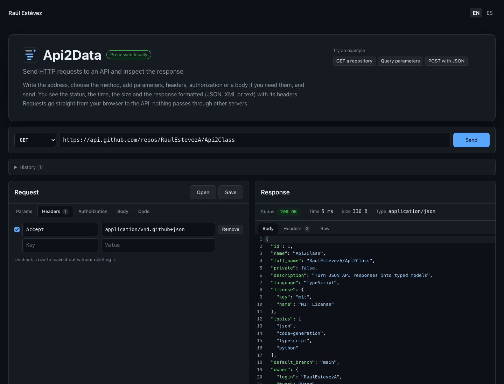

# Api2Data

Client-side tool to send HTTP requests to an API and inspect the response, **straight from the browser, without any server in between**.

- 🇬🇧 **English:** [Full documentation](./README_en.md)
- 🇪🇸 **Español:** [Documentación completa](./README_es.md)

  

## What is this repository?

Api2Data is a simple API client: write the address, choose the method, add parameters, headers, authorization or a body if you need them, and send. The response shows its status, time, size and content type, with the body formatted and highlighted (JSON, XML or text), its headers and the raw text. When a request is blocked, it explains why in words, including CORS.

It does less than Postman on purpose: one screen, the request on one side and the response on the other, and the less common options out of sight until they are needed. It also keeps a local history, imports cURL commands, writes the request as cURL, JavaScript or Python, and saves requests as files.

There are two versions that behave the same, checked by shared test cases:

- **[Web](https://raulesteveza.github.io/tools/Api2Data/)**: React + TypeScript, in the browser.
- **[Desktop](./desktop/README_en.md)**: Python + PySide6. Installable app for Windows, macOS and Linux. Without a browser in between, CORS does not apply: APIs that block web pages answer here.

It belongs to the same family as [Api2Class](https://github.com/RaulEstevezA/Api2Class), [Mapper](https://github.com/RaulEstevezA/Mapper), [Model2DB](https://github.com/RaulEstevezA/Model2DB) and [DataCleanr](https://github.com/RaulEstevezA/DataCleanr): the JSON an API returns here is what Api2Class turns into typed models.

## Suggestions

Ideas for improvements or bugs: write to [contact.raulesteveza@gmail.com](mailto:contact.raulesteveza@gmail.com).

## Developer

**Raul Estevez**

- [Personal Website](https://raulesteveza.github.io/)
- [LinkedIn Profile](https://www.linkedin.com/in/raulesteveza/)

## License

[MIT](./LICENSE)
